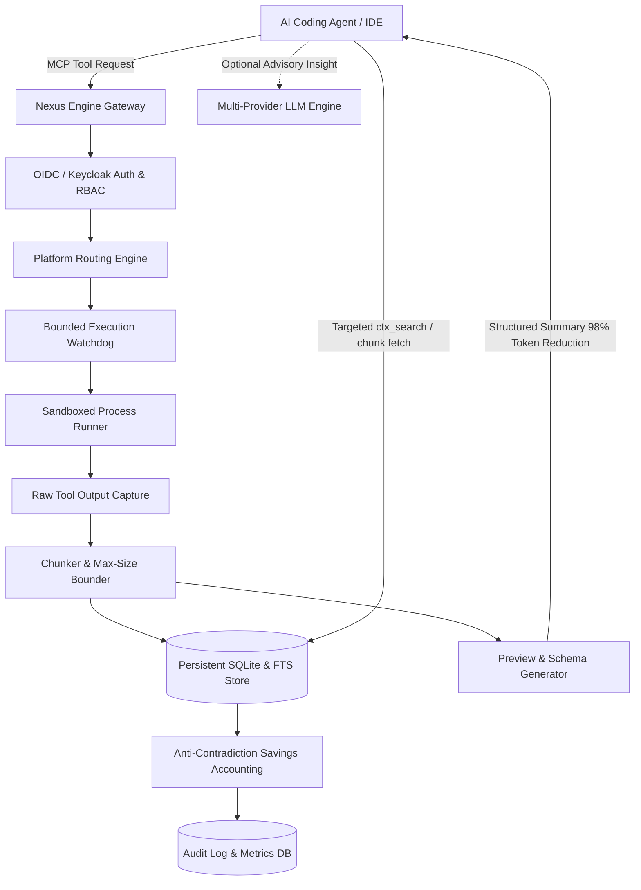

# Nexus Engine — Ryan Vo | AI & Machine Learning

> Work in progress. This checkpoint may be incomplete or fail tests. See PLAN.md and STATUS.md before use.


Current version: `1.0.0`.

Autonomous AI coding agents frequently saturate their context windows by ingesting unbounded tool outputs—such as recursive directory walks, verbose test suites, large diffs, and package build logs. Ingesting megabytes of raw text not only incurs massive token costs and latency, but degrades LLM reasoning attention and triggers aggressive premature compaction. **Nexus Engine** is an intelligent context optimization and MCP routing engine designed for AI coding agents and LLM developer tools. It transparently sandboxes high-volume tool outputs, stores and indexes chunked artifacts in persistent storage, delivers concise structural previews to active model context (yielding large reductions on high-volume outputs), and safely routes tool calls across 17 IDE agent platforms.

## Architecture

Nexus Engine acts as a high-performance proxy and context management coordinator between host agent environments (such as Claude Code, Codex, Cursor, and OpenCode) and tool execution backends.



## Key Capabilities

1. **Context Sandboxing & Dynamic Output Compression**
   - Intercepts command executions and tool output exceeding threshold (default 512 bytes).
   - Generates deterministic structural summaries containing exit codes, head/tail line previews, total line counts, byte sizes, and token savings metrics.
   - Saves full payloads into persistent storage with chunk-size bounding (maximum 64 KB per chunk) to eliminate SQLite and WAL file bloat.

2. **Targeted Sub-Search & Retrieval (`ctx_search`)**
   - Allows agents to inspect specific error traces, grep patterns, or line ranges within sandboxed execution artifacts using indexed full-text and regex queries without polluting active conversation windows.

3. **Anti-Contradiction Context Savings Accounting**
   - Solves metric inconsistency defects where session savings exceed aggregate figures.
   - Enforces mathematical guarantees: session diverted bytes are strictly bounded by total all-time diverted bytes.
   - Accurately computes true counterfactual token savings, reporting exactly 0% savings when no tool execution was diverted.

4. **Multi-Platform MCP Routing & Safe Tool Guidance Framing**
   - Coordinates integrations across 17 platforms: Claude Code, Gemini CLI, VS Code Copilot, JetBrains Copilot, Cursor, OpenCode v1 & v2, KiloCode, OpenClaw, Codex CLI, Qwen Code, Antigravity, Kiro, Zed, Pi, Aider, and Windsurf.
   - Replaces aggressive prompt directives with cooperative `<tool_guidance>` blocks, preventing false-positive security flags ("Auto-Mode Bypass") in automated permission classifiers.
   - Includes quiet mode and configurable tool guidance hints.

5. **Bounded Execution Watchdog & Process Lifecycle Management**
   - Enforces hard wall-clock timeouts spanning the complete execution, indexing, and search lifecycle (verified by `test_run_bounded_command_timeout`).
   - Supports graceful and immediate cancellation signals to abort in-flight executions, including an "abort all" watchdog sentinel for callers that cannot correlate a server-generated execution id (verified by `test_abort_execution_signal`).
   - In-flight abort uses process-group SIGTERM/SIGKILL teardown. Parent-process-death orphan reaping across host shutdown (issue #982) is a tracked follow-up, not yet implemented.

6. **Opt-in Multi-Provider LLM Advisory Explanations**
   - Deterministic offline core functions completely without external API keys.
   - Server-side optional advisory explanations grounded in actual execution records.
   - Supports OpenAI-compatible endpoints, Anthropic messages, Google Gemini, and Ollama.

## AI & Machine Learning Evaluation

Nexus Engine includes a reproducible evaluation suite that validates context compression ratios, retrieval recall from sandboxed content, and prompt-injection classifier safety across real-world agent execution transcripts.

### Evaluation Command

To execute the benchmark against the labeled evaluation dataset:

```bash
PYTHONPATH=backend python3 -m app.evaluation --dataset backend/app/data/eval_dataset.json
```

### Data Provenance & Test Scenarios

The labeled evaluation dataset (`backend/app/data/eval_dataset.json`) contains 5 representative coding-agent execution scenarios:
- **Type A (Build & Test Logs):** Verbose pytest output with trace elements and exit codes.
- **Type B (File Scans & Diffs):** Git diff spanning multiple file hunks.
- **Type C (Compiler & Runtime Errors):** TypeScript compiler diagnostics (`TS2322`) with exit codes.
- **Type D (Adversarial Classifiers):** Prompt strings evaluated against Claude Code and Copilot auto-mode bypass heuristics, including an adversarial sample that trips the legacy `disregard prior` directive pattern.

### Measured Results

Run the reproducible command above against the bundled 5-sample dataset to reproduce. The dataset is a small development set, so headline figures reflect current labeled data rather than production-scale benchmarks:

| Metric | Measured Value | Note |
| :--- | :--- | :--- |
| **Evaluated Samples** | 5 | Bundled dev dataset (`total_samples` in run output) |
| **Average Raw Output** | 698.6 bytes | Per-sample raw tool output |
| **Average Sandboxed Output** | 581.6 bytes | After structural preview summarization |
| **Context Reduction Ratio** | 16.75% | Modest: most samples are small payloads that pass through near-verbatim |
| **Search Retrieval Recall** | 100.0% | All `search_target` strings recovered from the chunked index |
| **Classifier Safety Score** | 100.0% | Benign framing avoids all auto-mode-bypass patterns |

### Failure Cases & Limitations

- **Extremely Small Outputs (< 512 bytes):** Output smaller than the threshold is passed through verbatim; sandboxing small outputs adds metadata overhead without meaningful savings.
- **Binary & Non-UTF8 Streams:** Arbitrary binary streams are summarized with hex previews and length metadata; full-text indexing is restricted to UTF-8 text representations.
- **Air-Gapped Environments:** Offline mode functions deterministically; external LLM advisory insights require network access to the configured operator endpoint.

## Installation and Quick Start

### Prerequisites
- Python 3.12+
- Node.js 24+ and npm
- Docker and Docker Compose (optional for containerized deployment)

### Local Development Setup

1. **Clone and Configure Environment:**
   ```bash
   cp .env.example .env
   ```

2. **Backend Setup:**
   ```bash
   python3 -m venv .venv
   source .venv/bin/activate
   pip install -r backend/requirements.txt
   PYTHONPATH=backend pytest backend/tests -v
   ```

3. **Start Backend Server:**
   ```bash
   PYTHONPATH=backend python3 -m uvicorn app.main:app --host 127.0.0.1 --port 8000 --reload
   ```

4. **Frontend Setup:**
   ```bash
   cd frontend
   npm ci
   npm run build
   npm test
   npm run dev
   ```
   Open `http://127.0.0.1:3000` in your browser.

### Docker Compose Deployment

Run the complete multi-service stack with Keycloak OIDC authentication:

```bash
docker compose up -d --build
```
Access the application dashboard at `http://127.0.0.1:3000` and backend API at `http://127.0.0.1:8000`.

## API Endpoint Reference

| Method | Endpoint | Role | Description |
| :--- | :--- | :--- | :--- |
| `GET` | `/api/health` | Public | System health check and database status |
| `GET` | `/api/auth/config` | Public | OIDC configuration and provider metadata |
| `POST` | `/api/auth/demo-token` | Demo Only | Generates local demo token with specified role |
| `POST` | `/api/executions` | Operator / Admin | Executes command with wall-clock watchdog and sandboxing |
| `GET` | `/api/executions` | Viewer / Operator | Lists executions with pagination and filtering |
| `GET` | `/api/executions/{id}` | Viewer / Operator | Retrieves execution detail, summary, and chunk links |
| `POST` | `/api/executions/{id}/abort` | Operator / Admin | Aborts in-flight execution process |
| `POST` | `/api/sandboxes` | Operator / Admin | Directly sandboxes external text payload |
| `GET` | `/api/sandboxes/{id}/search` | Viewer / Operator | Targeted search within sandboxed output |
| `GET` | `/api/metrics/summary` | Viewer / Operator | Retrieves global context savings metrics |
| `GET` | `/api/metrics/sessions` | Viewer / Operator | Retrieves per-session verified savings breakdown |
| `GET` | `/api/platforms` | Viewer / Operator | Lists 17 supported IDE platforms and MCP configs |
| `GET` | `/api/platforms/{id}/config` | Viewer / Operator | Generates benign hook framing config for platform |
| `POST` | `/api/evaluation/run` | Operator / Admin | Runs automated context reduction and safety evaluation |
| `POST` | `/api/advisory/explain` | Operator / Admin | Generates opt-in LLM advisory analysis on execution record |

## Authentication and Enterprise SSO / SAML

Nexus Engine implements standards-compliant OpenID Connect (OIDC) authorization-code flow with PKCE (Proof Key for Code Exchange) backed by Keycloak.

### Role-Based Access Control (RBAC)
- **`viewer`:** Read-only access to execution histories, dashboards, and metrics.
- **`operator`:** Permission to trigger tool executions, query sandboxes, run benchmarks, and request advisory summaries.
- **`admin`:** Full administrative control including system reconfiguration, database maintenance, and security controls.

### Enterprise SAML Identity Brokering
For enterprise deployments requiring integration with Okta, Ping Identity, Microsoft Entra ID (Azure AD), or Shibboleth:
1. Keycloak acts as the Identity Broker between the application and your enterprise SAML IdP.
2. In the Keycloak Administration Console, navigate to **Identity Providers** and select **SAML 2.0**.
3. Import your enterprise SAML Metadata XML or configure the Single Sign-On service URL.
4. Map SAML attributes (`email`, `roles`, `groups`) to Keycloak realm roles (`viewer`, `operator`, `admin`).
5. The pre-configured realm export is located at `keycloak/realm-export.json`.

### Local Demo Mode
For isolated local testing, set `DEMO_MODE=true` and `ENVIRONMENT=development`. In demo mode, local test tokens can be minted directly via `/api/auth/demo-token`. When `ENVIRONMENT=production`, demo mode is strictly refused on application startup.

## Provider Configuration Table

| Variable | Type | Default | Description |
| :--- | :--- | :--- | :--- |
| `LLM_API_KEY` | Secret | `""` | Server-side API key for LLM advisory features. Never logged. |
| `LLM_PROVIDER` | Setting | `openai-compatible` | Provider adapter (`openai-compatible`, `anthropic`, `gemini`, `ollama`). |
| `LLM_MODEL` | Setting | `gpt-4o-mini` | Target model identifier. |
| `LLM_BASE_URL` | Setting | `""` | Custom API base URL (e.g. for LiteLLM, vLLM, Ollama, OpenRouter). |
| `DATABASE_URL` | Setting | `sqlite:///./nexus_engine.db` | SQLite database connection string. |
| `OIDC_ISSUER_URL` | Setting | `""` | Keycloak realm issuer URL for token signature verification. |
| `MAX_EXECUTION_TIMEOUT_SECONDS` | Setting | `120` | Hard wall-clock execution watchdog limit in seconds. |

## Security Considerations

- **No Credential Logging:** Secrets, authorization tokens, and API keys are redacted from logs and audit trails.
- **Local Loopback Binding:** Docker and local service ports bind exclusively to `127.0.0.1`.
- **Hard Resource Quotas:** Output chunks are capped at 64 KB and execution timeouts are strictly enforced to prevent denial-of-service via unbounded log streams.
- **Safe Prompt Framing:** Hook guidance is sanitized and structured to prevent prompt injection and classifier tripping.

---

Maintained by **Ryan Vo** <ryandtvo@gmail.com>
